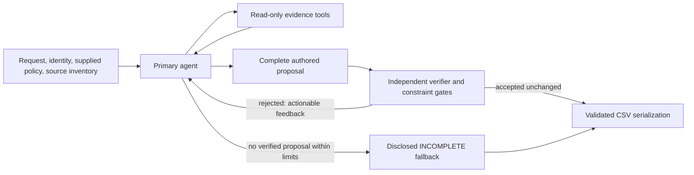

# Agent-first architecture — offline implementation, 2026-10-25

This records the original offline implementation. The follow-up
[`AGENT_FIRST_REVIEW_FIXES.md`](AGENT_FIRST_REVIEW_FIXES.md) documents the separately selectable
live integration and authorization corrections; its readiness notes supersede the offline-only limits below.

Starting checkout: existing main at `7ac9b34`. The deterministic implementation stays the default
baseline. No branches/worktrees, push, paid API calls, catalog calls or new model experiments were
performed. The earlier paid campaign remains closed.

## Authority changes

Baseline: deterministic request processing → deterministic plan → optional fact investigator →
deterministic re-plan → verifier → CSV.

Agent-first: subject identity/policy/source context → primary agent chooses evidence tools →
**agent authors authorization, final status, resources, operations, states, citations and all steps**
→ independent verification → accept unchanged, or feedback and another turn → explicit fallback
when exhausted. No initial candidate plan is generated or supplied. Jev is not required.



`ghostaudit/agent_first.py` contains the new execution loop and proposal verifier.
`audit.py` branches **before** request classification and `plan_case`. In this mode it calls neither
`decide_intents` nor `plan_case`, `withhold`, or the investigator's `_replan`. `CasePlan` is reused
solely as the existing row/diagnostic data container. Tests make planner/classifier calls raise
exceptions to prove they are absent. The shared investigator object supplies only controlled
tool execution and budget accounting; it never authors or re-plans an agent-first answer.

The agent sees request text/time, deterministic subject identifiers, supplied policy rows, allowed
operation ordering and eligible source inventory. Case IDs, expected labels, baseline status,
obligations and steps are not supplied. It dynamically uses search, source/media inspection,
timelines and parameterized SQL queries. Optional `propose_fact` adds validated literal evidence
for the verifier; it does not invoke a planner or determine the final answer.

## Proposal and verification contract

`submit_audit` takes:

- `authorization`: decision, ACCOUNT/ITEM/NONE scope, item category, whole-category flag, verbatim
  request quote and rationale.
- `deletion_status` and the complete `steps` array, including step numbers and all seven fields.
- `witnesses`: matching source, retrieved locator and literal for every cited step.

The proposal is schema-checked and verified as a whole. Deterministic code checks:

1. Request quotes, known non-deletion/preservation/hypothetical constraints, subject resolution,
   item category, single-item ambiguity and prohibition on account/category scope widening.
2. Strict step schema, allowed tuples, consecutive numbering, canonical order, finding/remediation/
   verification chains, and citation requirements.
3. Resource handles actually retrieved, full shown-line witnesses, source/observation cutoff and
   independent ownership. An absent ID may use a retrieved collection/schema witness only when
   the verifier establishes category-matching exhaustive omission; no absent literal is invented.
4. The existing independent verifier's policy, coverage, copy, stale-citation and cross-person checks.
   Additional strict policy treatment checks also examine owned resources omitted from the proposal,
   so omitting an undated retained record cannot evade retention restrictions.
5. Agent facts cannot re-date future observations or temporally conflicted exports to their earlier
   file capture time. A submission must be the last call in a batch, so later facts/tools cannot
   silently invalidate an accepted proposal.

Accepted semantic fields are preserved. Serialization may format JSON/CSV, but an out-of-order or
unsupported proposal is rejected, not silently repaired. Rejections return codes, messages and
resource/source hints through the tool result. A later full proposal is checked afresh. One bounded
native-schema repair is available; rounds, tool calls, context/output tokens and case budgets remain
bounded. Raw proposals, fact rejections and verifier feedback are saved in `case_files.jsonl`.
All primary-agent feedback consumes the same overall turn/tool/token limits; the shared baseline
config's separate investigator feedback allowances do not grant additional primary-agent turns.

Failure produces `INCOMPLETE` with an empty step list, explicitly marked `AGENT_UNVERIFIED` in
hash-bound run disclosures. This is uncertainty, not proof that data remains. No baseline answer
or unsubmitted fact is substituted. The original submission is not regenerated.

## What remains a semantic model decision

The general-purpose agent interprets request meaning beyond the deterministic English guard's
coverage and chooses the complete answer. A literal quote alone cannot prove an interpretation is
correct. Unknown-language and subtle authorization reasoning still need independent model/holdout
evaluation; code is not claimed to be a complete natural-language oracle. Known preservation,
single-item and policy restrictions remain hard constraints.

The initial COMPLETE-account gate is deliberately conservative: it requires an owned profile ID.
It does not yet accept completion solely from the baseline's subject-level absence argument when
no profile ID is grounded. Non-deletion also requires independent confirmation by the current
guard. These can increase disclosed fallbacks; they do not trigger planner overwrite. Expanding
either requires explicit independent proof and tests, not guessed IDs or weaker evidence.

## Selecting the mode and models

```sh
# Fresh output/run paths; no environment-file loading or network access.
python3 code/main.py audit --decision-mode agent-first --provider roar \
  --agent-model claude-haiku-5-5 --agent-cache .cache/ghostaudit \
  --requests dataset/sample_deletion_requests.csv \
  --output .runs/agent-first-demo/predictions.csv --run-dir .runs/agent-first-demo

# Optional cached Jev media interpretation; request intent still belongs to the primary agent.
# Add --intent jev, or --media-cache <historical media_extractions.json> for cached screenshot tools.
```

TokenBazaar and Roar use the existing provider-neutral native-tool gateway. `--agent-model` accepts
a general-purpose model ID, e.g. the provider's Gemini or Claude model. This implementation does not
assert new live compatibility or quality for any model. The CLI enforces zero call/cost allowance,
copies caches before validation, never loads `.env` or retrieves pricing, and has no live-mode flag.
Library callers must use an in-memory `ReplayGateway` or a zero-call cache gateway tagged replay;
merely changing a normal gateway's mode label is insufficient. Optional media gateways must also
be offline. Future live enablement needs a separately authorized change/experiment.

Defaults: 8 agent turns, 40 tool calls, 120k conservative per-case token admission limit, 6,000
completion tokens. Use `--agent-max-rounds`, `--agent-max-tool-calls` and
`--agent-max-completion-tokens` to adjust offline experiments. Baseline flags/defaults are unchanged.

## Offline measurements

These measurements distinguish a scripted architecture test from real-model accuracy.

| Four independent synthetic scenarios | Baseline | Scripted primary agent |
| --- | ---: | ---: |
| Correct status | 4/4 | 4/4 |
| Exact rows | 3/4 | 4/4 |
| Step precision | 8/8 | 11/11 |
| Step recall | 8/11 | 11/11 |
| Correct expected cited steps | 4/5 | 5/5 |

The extra exact row is a captured attachment in an unparsed PDF: the baseline emits three profile
steps; the agent retrieves the PDF, proposes validated ownership/category/state, and authors six
steps including the attachment. A separate same-input test selects either of two legitimate
citations; each chosen citation survives unchanged, proving the agent owns semantic output fields.
Other scripted tests accept COMPLETE and NOT_APPLICABLE without invoking the planner.

In a deliberately adversarial repair trace, one fabricated proposal is rejected and one corrected
proposal accepted: verifier rejection **1/2**, detected grounding/hallucination proxy **1/2**. The
final answer contains no detected unsupported resource. In the four positive scenarios rejection
and grounding-rejection rates are 0/4 proposals. These are controlled test counts, not empirical
model hallucination rates or confidence intervals.

The **public 32-case cache-availability check** found no compatible new-protocol agent responses.
Historical caches contain typed decisions, vision readings and fact-investigator conversations,
not `submit_audit` proposals. Replaying them as final answers would be invalid. All 32 cases therefore
produce disclosed fallbacks: 22/32 statuses, 0/32 exact rows, recall 0/193, precision undefined,
0/75 matching cited steps, zero proposals and undefined proposal rejection/hallucination rates.
This measures cache absence and fallback safety, **not agent-first model capability**. The freshly
replayed current Roar baseline has 28/32 statuses, 1/32 exact rows, 141/142 precision, 141/193 recall
and 56/75 matching cited steps. No real-model accuracy improvement is claimed.

`evaluation/agent_comparison.py` measures exact/status/step/field/sequence and cited-step correctness
from frozen outputs and rejection/grounding metrics from proposal traces. Agent output hashes are
checked before attribution. `hallucination_rate_proxy` means the fraction of submitted proposals
with detected invented/unsupported/cross-person/unshown evidence; it is not an exhaustive semantic
hallucination detector. No proposals yields null, never a misleading zero rate.
Proposal rates count schema-valid submissions processed by the verifier; native schema repairs are
recorded separately. Baseline has no primary-agent submissions, so its proposal-level rates are N/A.

Baseline gap reconstruction explicitly refuses agent-first manifests instead of pretending that
baseline obligations explain an agent-authored decision. Use proposal traces and output comparison.

## Validation and next step

21 focused tests cover planner/Jev bypass, authored statuses/resources/operations/citations,
unparsed discovery, feedback repair, native schema repair, batch finality, live/cache-miss guards,
original-cache preservation, ambiguous and widened item scope, wrong policy, missing retention,
unretrieved/late citations and future-event re-dating.

| Final verification | Python 3.11.13 | Python 3.14.7 |
| --- | --- | --- |
| Complete suite | 328/328 | 328/328 |
| TokenBazaar + Roar suites | 31/31 | 31/31 |
| Existing baseline fixtures | 13/13 exact | 13/13 exact |
| Full baseline offline + staged replay | 518 cases each, zero paid calls | same |

Ruff and diff checks pass. Baseline offline, sample and staged outputs are byte-identical to the
pre-change quality checkpoint across both Python versions and hash seeds 1/777. Staged replay has
533 cache hits and matches preserved root output. External network connections were blocked during
verification; the earlier paid ledger is still closed with its original 177 events.

A full 518-case no-response agent run is structurally validated with 518 disclosed fallbacks; it is
not a replacement submission. No new paid model call was made, and all original protected file
hashes, caches, datasets, output and recovery stashes are preserved. Raw replay traces, fixture
comparisons and test logs live under ignored `.runs/agent-first-offline-6i48y0w_/`.

The next necessary evidence is a separately authorized, capped general-model run using this exact
proposal protocol on an independent grounded holdout. Measure useful final proposals, rejection
repair success, unsupported final steps, cost and latency, then compare public samples/full outputs.
Until then this is an implemented and offline-validated architecture, not a demonstrated leaderboard
improvement. The deterministic baseline remains selectable and unchanged.
